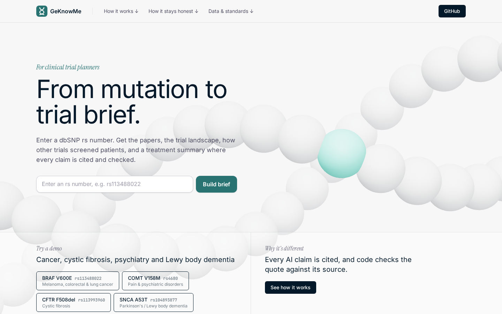
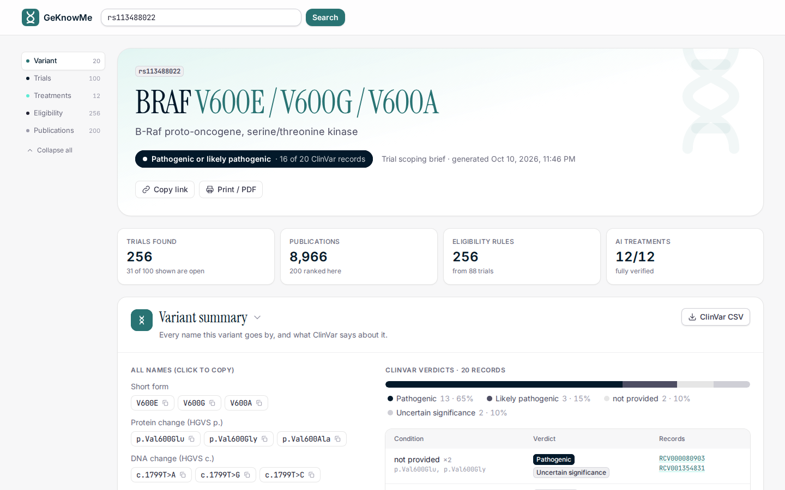
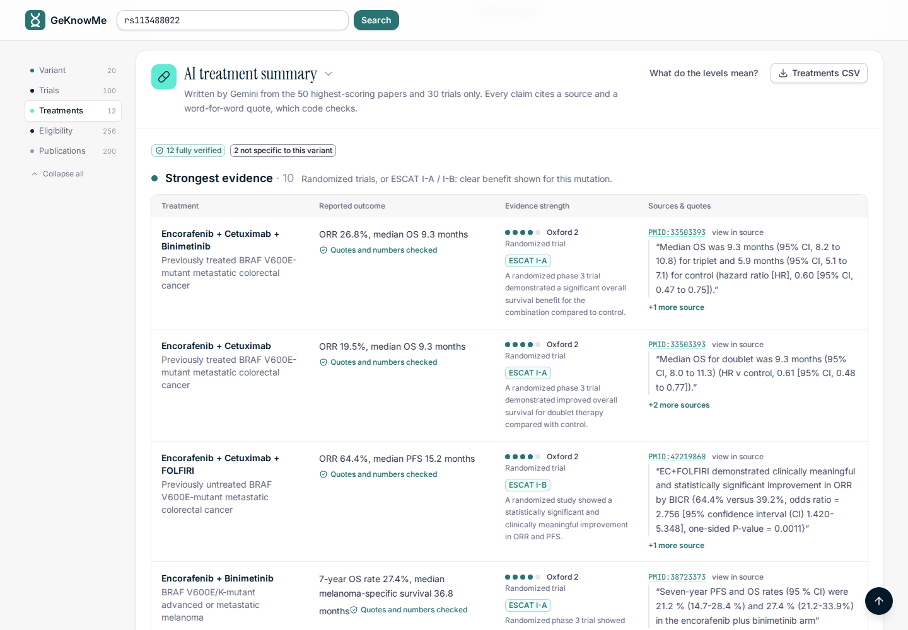

# GeKnowMe

**From a genetic variant to the clinical trials that matter, in one search.**

Enter a dbSNP rs number and GeKnowMe builds a cited brief: whether the variant matters, which clinical trials are studying it and at what phase, how those trials screen patients, the best published evidence, and an AI treatment summary where code checks every claim against its source.

**Live:** https://hackathon-26-ijj5.onrender.com · Built at HackRU 2026.



## The problem

Clinical trial information is scattered. Trials, papers and variant records live in separate databases, and each one names the same variant differently: `rs113488022`, `V600E`, `p.Val600Glu` and `c.1799T>A` are all one mutation. A doctor who sees an unfamiliar variant on a test result has to search each database under every name, then read trial records one by one. That can take hours, and for many of these diseases speed is key to treatment. GeKnowMe puts it in one place: type the variant's rs number (its standard ID) and get the whole picture in seconds.

## Who it's for

- **Clinicians (main user).** A PCR or genetic test comes back with an unfamiliar mutation. Is it a meaningful marker for the disease being treated? If so, what trials are studying it, how far along are they, and could the patient enroll?
- **Small biotech and diagnostics companies.** A fast first look at a variant's trial landscape, without a full genomics team.
- **Large pharma.** A quick preliminary scan of competing programs before committing to a drug target.

## What you get from one rs number

| Section | What it shows |
|---|---|
| **Variant & names** | Gene, every notation (rs, protein short and long form, DNA change, names used in the literature) and ClinVar significance, with a one-line verdict (e.g. "pathogenic or likely pathogenic, 16 of 20 ClinVar records") and where each name came from |
| **Trial landscape** | Every matching ClinicalTrials.gov study: a phase pipeline, the trials recruiting now, which ones stopped early, and the most-tested drugs, with filters for open trials |
| **Eligibility benchmark** | The biomarker inclusion and exclusion rules other trials used, quoted word for word, and how often each screening pattern appears |
| **Publications** | Up to 200 PubMed papers, ranked by study design (Oxford CEBM levels) and relevance |
| **AI treatment summary** | A treatment table written by Gemini from the top sources only, where code checks every source ID, quote, number and evidence tier |

Every item links to its source, and every section exports to CSV.



## Try it

The demo buttons on the home page load saved briefs instantly:

| Variant | rs number | What it shows |
|---|---|---|
| BRAF V600E | `rs113488022` | A well-studied cancer mutation: 256 trials, approved drug combinations at the top of the AI table |
| CFTR F508del | `rs113993960` | Cystic fibrosis: 114 trials, Trikafta as the top row, backed by a meta-analysis |
| SNCA A53T | `rs104893877` | Parkinson's / Lewy body dementia: pathogenic, but no trial names the variant; 14 open trials for the disease; the treatment evidence is almost all preclinical |
| COMT V158M | `rs4680` | A common variant that ClinVar calls benign, with no open drug trials: the brief answers "probably not a treatment target" |

KRAS G12C (`rs121913530`), EGFR L858R (`rs121434568`), SNCA E46K (`rs104893875`) and TTR V30M (`rs28933979`) are also saved. Any other rs number is built live, in about 3 seconds plus 10 to 60 seconds for the AI table.

## How GeKnowMe meets the judging criteria

| Criterion | Where to see it |
|---|---|
| **Utility & relevance:** solves a real bottleneck in medicines development | Finding which trials exist for a variant, at what phase, and how they screen patients takes hours of searching across PubMed, ClinicalTrials.gov and ClinVar under every name the variant goes by. GeKnowMe does it in seconds, for clinicians deciding what to do for a patient and for teams scoping a drug program (including cancer therapeutics: see the BRAF V600E demo). |
| **Readiness:** functional, replicable, ready to deploy | Live at https://hackathon-26-ijj5.onrender.com · public GitHub repo · [MIT license](LICENSE) · runs locally with a few commands ([below](#run-it-locally)) · 180 automated tests that run offline · single-service deploy via `render.yaml` · every failure of an outside service is contained to its own section |
| **Design & packaging:** demo video, slide deck, intuitive UX, clear docs | [Slide deck](docs/GeKnowMe_slides.pptx) · demo video: [link] · four one-click demo variants on the home page · every claim links to its source and every section exports to CSV · this README |

## Why the trial phase matters

The phase of each trial tells a clinician what they can actually do next, so GeKnowMe puts it front and center:

| What the brief shows | What it means for the patient |
|---|---|
| **Recruiting, Phase 3** | A treatment close to standard care; an eligible patient may want to enroll |
| **Recruiting, Phase 1 or 2** | Early access to a new treatment, often for patients who are out of options |
| **Completed, with results** | Findings that can inform treatment today |
| **Stopped early** (terminated, withdrawn) | Paths that already failed, so no time is wasted on them |
| **Observational only** | Studies of the disease, not of a treatment: nothing to try yet |

The shape of the pipeline matters too. For SNCA A53T, almost nothing has reached the later phases, so an early trial, or the center running it, may be the realistic path.

## How it compares

| Tools | What they do | Built for |
|---|---|---|
| Tempus (TIME), Deep 6 AI, Genotrial | Mine health records and genomic data to match patients to trials and speed up recruitment | Trial sponsors and sites |
| Citeline Trialtrove, Medidata, Veeva, IQVIA | Trial strategy, benchmarking and operations | Pharma running trials |
| OncoKB, CIViC | Curated evidence on what a cancer variant means for treatment | Oncology, cancer variants only |
| **GeKnowMe** | The trial landscape and evidence for one variant, cited and checked | The clinician and the patient, for any disease |

GeKnowMe needs **no patient data**, just an rs number. It covers any variant, uses live trial data, and is free and open source.

## How it works

```
rs number
   │
   ▼
[1] Variant lookup     MyVariant.info + ClinVar + NCBI LitVar2 (literature names)
   │
   ▼
[2] Aliases            every name the variant goes by, and the search terms built from them
   │
   ├────────────────────────────┐
   ▼                            ▼
[3] Papers (PubMed)       [4] Trials (ClinicalTrials.gov)      run at the same time
   │                            │
   │                            ▼
   │                      [5] Eligibility rules                 rule-based, no AI
   ▼                            ▼
   └──────► code ranks the sources and picks the top 50 papers + 30 trials
                       │
                       ▼
             [6] AI treatment table (Gemini) ──► proof check (code) ──► brief
```

The website first loads steps 1 to 5 (fast) and then the AI table on its own, so everything else is usable while the AI works. If an outside service fails, only that section shows an error; the rest of the brief still loads.

## Eligibility rules: how other trials screen

For every matching trial, GeKnowMe reads the eligibility criteria and pulls out the rules that are about the variant, so a planner or clinician can see how comparable trials screen patients. This part is **rule-based, with no AI**: it is instant, free, gives the same answer every time, and every rule is quoted word for word with a link to its trial.

What the code does, in order:

1. **Splits** the criteria into inclusion and exclusion, using the section headers ("Inclusion Criteria", "Key Exclusion Criteria", ...).
2. **Splits each section into single rules** at bullets, numbers and line breaks, and drops lead-in lines such as "Patients must meet all of the following:".
3. **Keeps only rules about the variant**: rules that name the gene or any of the variant's names (including the codon-level form, e.g. "BRAF V600"), genetic testing, or prior targeted therapy.
4. **Skips drug-interaction and general medication rules** (CYP3A4 inhibitors, P-gp, anticoagulants, proton pump inhibitors, QT-prolonging drugs, ...) unless they name the gene or variant, because they are about the study drug's safety, not the variant.
5. **Puts each rule in one category**, checking the most specific first:

| Category | A rule goes here when it... | Example (BRAF V600E) |
|---|---|---|
| **Prior therapy** | mentions previous or current treatment with a targeted drug, inhibitor, modulator, gene therapy, or a drug for this gene | "Patients who have previously received BRAF inhibitors or irinotecan liposomes" (NCT06763029) |
| **Mutation required** | is an inclusion rule that names the variant, or the gene together with an alteration | "Documented BRAF V600E mutation in tumor and/or liquid biopsy detected by an analytically validated test." (NCT05503797) |
| **Other alteration excluded** | is an exclusion rule that names the variant or gene, another known driver (EGFR, ALK, KRAS, ...), or "known / another / additional" mutations | "Known co-occurring NF1 and/or RAS-related alteration known to cause resistance." (NCT06610682) |
| **Testing method** | says how the variant must be confirmed (NGS, PCR, ctDNA, central or local lab, FDA-approved or validated test) and is clearly about genetics | Rare for BRAF: most trials put the test inside the "mutation required" rule, as in the example above |
| **Other biomarker** | is an inclusion rule about another biomarker (EGFR, PD-L1, MSI, TMB, ...) | "RET activating point mutation (e.g., M918T)" (NCT07010393) |

6. **Caps** each trial at 8 rules, so one long protocol can't dominate.

The website then counts **screening patterns** across all trials and shows the share of trials using each one: require genetic confirmation, specify zygosity, accept blood-based testing (ctDNA), mention tumour tissue testing, require central lab confirmation, accept local lab results, require an FDA-approved or validated test, exclude prior gene-targeted therapy, require or allow prior therapy, and exclude other genetic alterations. The two cancer-only patterns (blood-based and tissue testing) are hidden for non-cancer variants. Click a pattern to see the quoted rules behind it.

For BRAF V600E this gives 256 rules from 88 trials: 115 "mutation required", 96 "prior therapy", 34 "other alteration excluded", 9 "other biomarker" and 2 "testing method". A protocol team can use it to benchmark a draft: if its rules are stricter than most comparable trials, the eligible patient pool shrinks.

### How trials and papers are ranked

Code, not the AI, decides which sources are strongest, and every score is shown on the site with its reasons.

| Trials: rule | Points |
|---|---|
| Randomized | +2 |
| Phase 3 or later / Phase 2 / Phase 1 | +3 / +2 / +1 |
| Has posted results | +4 |
| Names the exact variant in the title or inclusion criteria | +3 |
| Names the variant **only** in the exclusion criteria | −5 |
| Completed or active | +1 |
| Started in the last 5 years | +1 |

The top 30 trials go to the AI. Trials found only by a gene + disease search (when few trials name the variant) are shown and labelled "Disease-level match", but never sent to the AI. Papers are scored by study design (OCEBM level, below) plus relevance: the exact variant in the title (+3) or abstract (+1), results reported with numbers (+2), a named drug (+2), and recency (+2 for the last 5 years, +1 for 5 to 10). Papers about the gene but not the exact variant lose a point. The top 50 papers with an abstract go to the AI, at most 8 about the same drug.

## How the AI stays honest

Gemini only sees the top-ranked papers and trials, and must back every claim with a word-for-word quote. Then code, not the AI, checks every row:

| Check | Rule | If it fails |
|---|---|---|
| **Real source** | The cited PubMed or ClinicalTrials.gov ID must be one we gave the AI | Row removed |
| **Exact quote** | The quote must appear in that source's text (ignoring case, spacing and punctuation) | Row removed |
| **Numbers match** | Every number in the outcome must appear in one of the quotes | Row kept, flagged for a human check |
| **Tier fits** | The ESCAT tier must fit the cited study types (for example, I-A needs a randomized trial and a survival result) | Row kept, flagged |

Rows whose sources never mention the variant are labelled "not specific to this variant". On the site, "view in source" highlights the quote inside the original abstract. Across the four demo variants, 41 of 43 AI rows passed every check, 2 were flagged, and none cited an invented source or quote.



## Evidence standards

- **Oxford CEBM 2011 Levels of Evidence** ([OCEBM](https://www.cebm.ox.ac.uk/resources/levels-of-evidence/ocebm-levels-of-evidence)). Used to rank papers from their PubMed publication types, and to give every AI row the level of its strongest cited source, worked out by code. Two deliberate adjustments: single-arm Phase 1/2 trials are ranked at level 3 (in targeted therapy they are often the main evidence), and guidelines and narrative reviews, which OCEBM doesn't rank, get fixed points.
- **ESMO ESCAT** (Mateo et al., *Annals of Oncology* 2018, [doi:10.1093/annonc/mdy263](https://doi.org/10.1093/annonc/mdy263)). Used for cancer rows only, since it is an oncology scale. The AI proposes a tier and code checks it against the cited sources.

Paper and trial scores are shown next to each item, with the reasons (for example "OCEBM level 2 (randomized trial) +4", "exact mutation in title +3").

## Data sources

All free and public:

- [MyVariant.info](https://myvariant.info) (variant annotation, including ClinVar and dbSNP)
- [ClinVar](https://www.ncbi.nlm.nih.gov/clinvar/)
- [NCBI LitVar2](https://www.ncbi.nlm.nih.gov/research/litvar2/) (the names papers actually use)
- [PubMed E-utilities](https://www.ncbi.nlm.nih.gov/books/NBK25501/)
- [ClinicalTrials.gov API v2](https://clinicaltrials.gov/data-api/api)
- [Google Gemini](https://ai.google.dev/) for the treatment summary (`gemini-3.5-flash`, with `gemini-3.5-flash-lite` as backup)

## Run it locally

You need Python 3.14, Node 22, and a [Gemini API key](https://aistudio.google.com/apikey) for the AI table. An [NCBI API key](https://www.ncbi.nlm.nih.gov/account/settings/) is optional and raises the PubMed rate limit from 3 to 10 requests per second.

```bash
git clone https://github.com/Sousa-16/hackathon-26.git
cd hackathon-26
```

Create a `.env` file in the repo root:

```
GEMINI_API_KEY=your-key
# Optional: makes PubMed searches faster
NCBI_API_KEY=your-key
```

Build the website and start the server, which serves both the API and the site:

```bash
cd frontend && npm ci && npm run build && cd ..
cd backend && python -m venv .venv && .venv/bin/pip install -r requirements.txt
.venv/bin/uvicorn app.main:app --port 8000
```

Open http://localhost:8000. For frontend development with hot reload, keep the server running and run `npm run dev` in `frontend/` (it forwards `/api` to port 8000).

Without a Gemini key everything works except the AI table.

### API

| Endpoint | What it returns |
|---|---|
| `GET /api/brief/{rsid}?include_ai=false` | Steps 1 to 5 in a few seconds, with the AI table marked `pending` |
| `GET /api/brief/{rsid}/treatments` | The AI treatment table on its own (10 to 60 s) |
| `GET /api/brief/{rsid}` | The whole brief in one call |
| `GET /api/health` | Whether the server is up and the keys are set |

Add `?refresh=true` to skip the saved demo briefs. Interactive docs are at `/docs`.

### Tests

```bash
cd backend && .venv/bin/python -m pytest -q
```

180 tests, using saved replies from the outside services, so they run offline in about 2 seconds.

### Deploy

`render.yaml` describes the single [Render](https://render.com) web service: it installs the backend, builds the frontend, and serves both from FastAPI. Set `GEMINI_API_KEY` and `NCBI_API_KEY` in the service's environment.

## Project structure

```
backend/
  app/
    main.py              API, and serves the built website
    pipeline.py          runs steps 1 to 6; turns any failure into a warning for that section
    schemas.py           the data contract shared by every step and the website
    sources/
      variant.py         [1] MyVariant.info + LitVar2
      aliases.py         [2] every name and search term
      papers.py          [3] PubMed search and OCEBM scoring
      trials.py          [4] ClinicalTrials.gov search and scoring
      eligibility.py     [5] rule-based eligibility extraction
      ai_summary.py      [6] Gemini prompt and calls
      proof_check.py     [6] the code checks on every AI row
    demo_data/           saved demo briefs
  scripts/make_demo_briefs.py
  tests/
frontend/                React + TypeScript + Tailwind + Vite (Three.js on the landing page)
docs/PLAN.md             the original design
```

## Limitations

- **Trials that enroll by disease, not variant.** Many trials never name the variant, so a variant search misses them. When few trials name it, GeKnowMe adds gene + disease trials and labels them, but it can still miss some (for example, Phase 3 TTR amyloidosis trials don't show up for TTR V30M).
- **rs numbers only.** Lab reports often use HGVS names (`c.` / `p.`). Those are searched, but not yet accepted as input.
- **Abstracts, not full papers.** The AI reads titles, abstracts and trial summaries, and only the top 50 papers and 30 trials, so it can miss treatments.
- **ESCAT is simplified.** ESCAT defines "clinically meaningful benefit" with the ESMO-MCBS scale, which we don't compute.
- **Approximate totals.** Searches overlap, so total trial counts are estimates.
- **AI output varies.** Two runs can pick different treatments. Every row that is shown has passed the checks above, but the checks prove the quote exists, not that the AI interpreted the study correctly.

## Disclaimer

GeKnowMe is a research tool to speed up the search for trials and evidence. It is not medical advice. Check every claim against its linked source.

## Team

Lucca Sousa and Matheus Sousa, HackRU 2026.

## License

[MIT](LICENSE)
